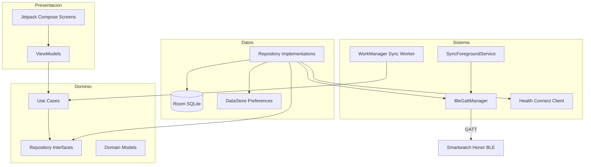
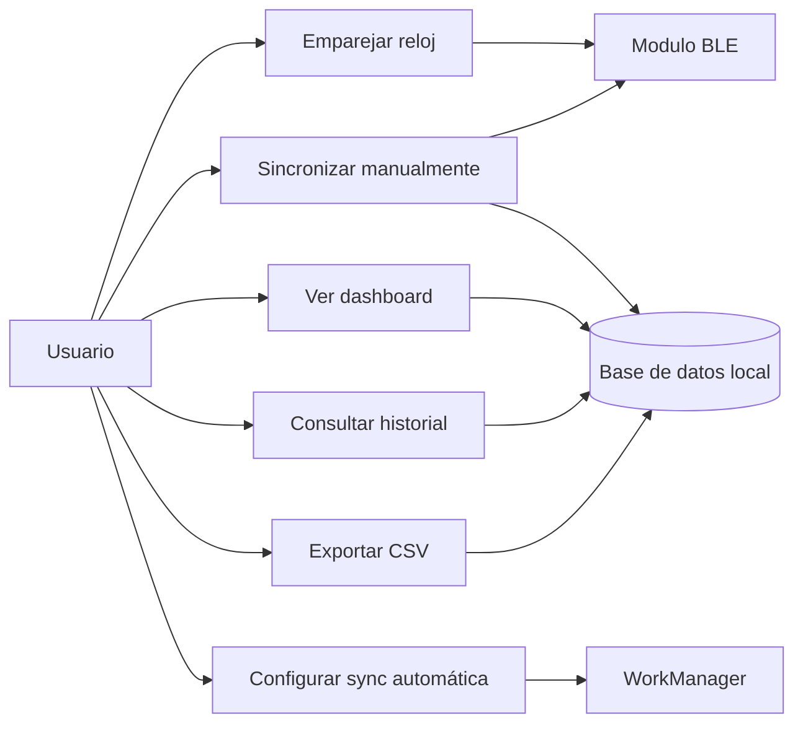
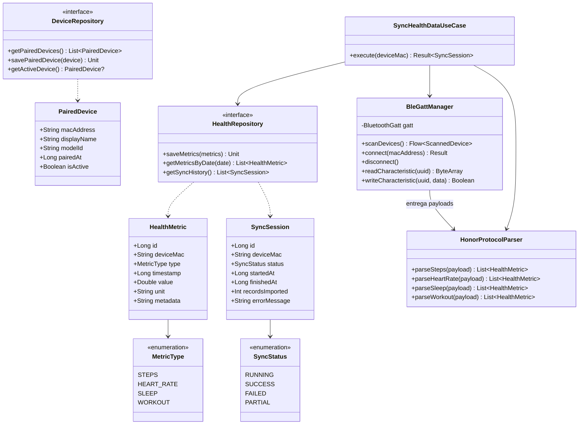
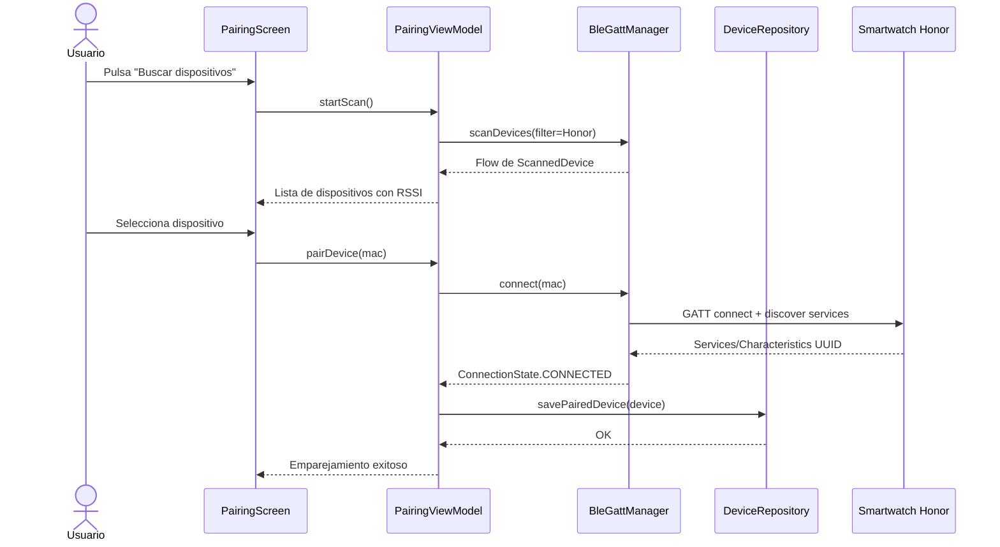
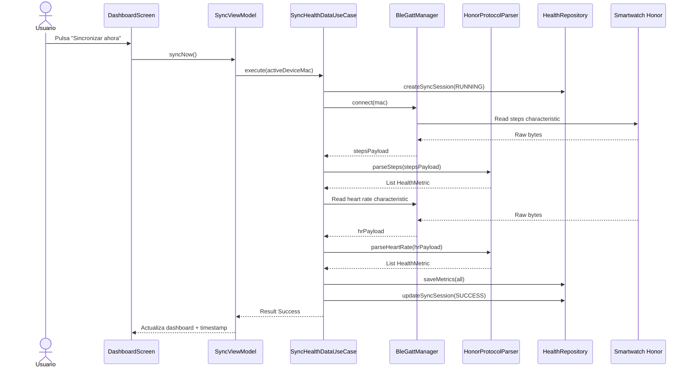
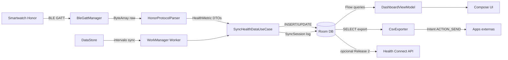
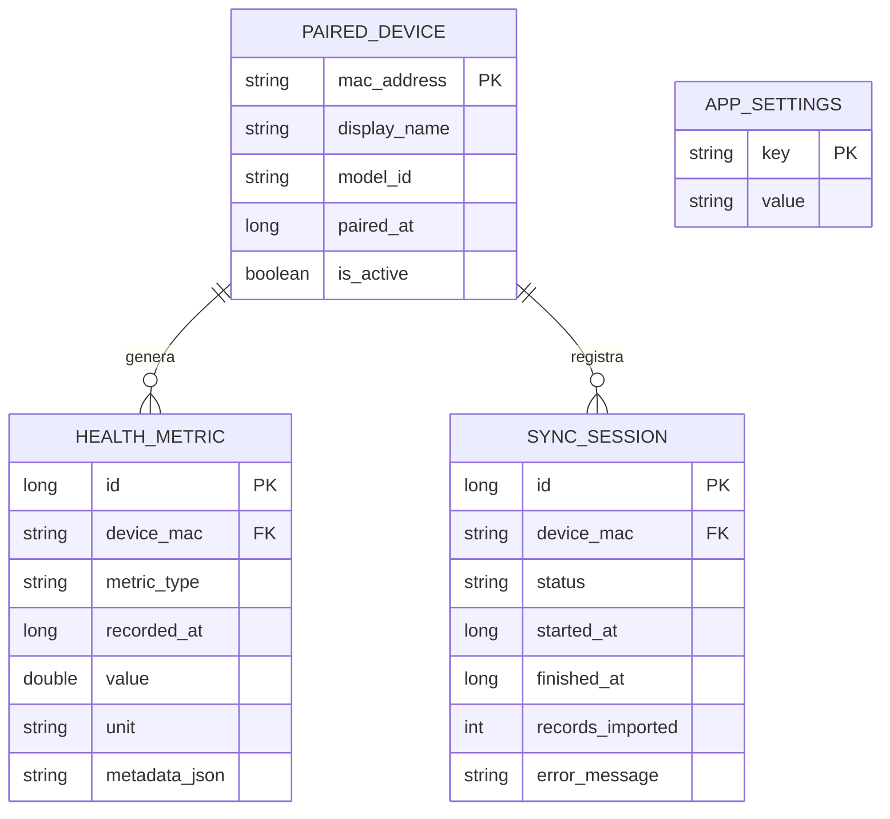

# Diseño y Arquitectura — Sync Honor Smartwatch

## 1. Resumen Ejecutivo

**Sync Honor Smartwatch** es una aplicación Android nativa que captura y almacena localmente los datos de salud de smartwatches Huawei Honor cuando la aplicación oficial (Huawei Health / Honor Health) deja de sincronizar correctamente por incompatibilidades de firmware, restricciones de HMS o políticas de batería de Android.

El sistema se conecta al reloj vía **Bluetooth Low Energy (BLE)** usando el protocolo GATT estándar y las características propietarias documentadas de la familia Honor Band/Watch, persiste los datos en una base de datos local y ofrece un dashboard para consulta y exportación.

**Alcance del MVP (Release 1):** emparejar un reloj Honor, sincronizar pasos y frecuencia cardíaca de forma manual, visualizar métricas del día actual y exportar historial a CSV.

**Usuario objetivo:** propietario de un smartwatch Honor que necesita recuperar el control de sus datos de salud sin depender de la nube de Huawei.

---

## 2. Requisitos Funcionales (RF)

| ID | Requisito | Prioridad | Módulo |
|---|---|---|---|
| RF-001 | Emparejar y guardar un smartwatch Honor vía BLE con validación de conexión | Must | Conexión BLE |
| RF-002 | Escanear y listar dispositivos BLE Honor/Huawei cercanos con RSSI | Must | Conexión BLE |
| RF-003 | Ejecutar sincronización manual bajo demanda del usuario | Must | Sincronización |
| RF-004 | Sincronizar automáticamente en segundo plano con intervalo configurable | Should | Sincronización |
| RF-005 | Capturar y almacenar pasos diarios (total y desglose horario) | Must | Captura de Datos |
| RF-006 | Capturar y almacenar mediciones de frecuencia cardíaca | Must | Captura de Datos |
| RF-007 | Capturar y almacenar sesiones de sueño (duración, fases básicas) | Should | Captura de Datos |
| RF-008 | Capturar y almacenar sesiones de entrenamiento (tipo, duración, calorías) | Should | Captura de Datos |
| RF-009 | Mostrar dashboard con métricas del día y última sincronización | Must | UI / Dashboard |
| RF-010 | Consultar historial de sincronizaciones con estado y timestamp | Must | UI / Historial |
| RF-011 | Exportar datos almacenados a archivo CSV compartible | Must | Exportación |
| RF-012 | Publicar pasos y frecuencia cardíaca en Health Connect de Android | Could | Integración |
| RF-013 | Gestionar más de un dispositivo emparejado | Could | Conexión BLE |
| RF-014 | Notificar al usuario el resultado de cada sincronización (éxito/error) | Should | Notificaciones |
| RF-015 | Configurar intervalo de sincronización automática (15/30/60 min, desactivado) | Should | Configuración |

---

## 3. Requisitos No Funcionales (RNF)

| ID | Requisito | Métrica medible |
|---|---|---|
| RNF-001 | Rendimiento de sincronización manual | Sincronización de pasos + FC completada en < 30 s con reloj a ≤ 3 m |
| RNF-002 | Consumo de batería en segundo plano | < 3 % de batería del teléfono en 24 h con sync cada 30 min |
| RNF-003 | Disponibilidad offline | 100 % de consulta de datos históricos sin conexión a Internet |
| RNF-004 | Seguridad de datos locales | Datos almacenados en almacenamiento privado de la app; sin transmisión a servidores externos |
| RNF-005 | Compatibilidad de dispositivos | Android 8.0+ (API 26); probado en Honor Band 6/7, Honor Watch GS 3 |
| RNF-006 | Usabilidad | Emparejamiento completable en ≤ 3 pasos desde pantalla principal |
| RNF-007 | Mantenibilidad | Cobertura de pruebas unitarias > 80 % en capa de dominio |
| RNF-008 | Recuperación ante fallos BLE | Reintento automático hasta 3 veces con backoff de 2 s antes de marcar error |
| RNF-009 | Tamaño de almacenamiento | Retención de 365 días de métricas sin superar 50 MB en SQLite |

---

## 4. Arquitectura del Sistema

La aplicación adopta una **arquitectura monolito modular Android** organizada en capas (Clean Architecture + MVVM). Toda la lógica reside en el dispositivo móvil; no hay backend remoto. La comunicación con el reloj ocurre exclusivamente por BLE GATT.

**Justificación:** el problema es local (sincronización dispositivo-a-teléfono), no requiere microservicios ni servidor. La separación en capas permite testear el parsing de protocolo BLE y la lógica de negocio sin hardware real.

---

## 5. Diagramas Técnicos

### 5.1 Diagrama de Casos de Uso

### 5.2 Diagrama de Clases (UML)

### 5.3 Diagrama(s) de Secuencia

#### 5.3.1 Emparejamiento BLE

#### 5.3.2 Sincronización manual de datos

---

## 6. Flujo de Datos

---

## 7. Modelo de Datos

Base de datos relacional local con **Room (SQLite)**.

**Tablas:**

| Tabla | Descripción | Índices clave |
|---|---|---|
| `paired_device` | Dispositivos emparejados. PK: `mac_address`. Solo uno con `is_active=1`. | PK en `mac_address` |
| `health_metric` | Métricas de salud. PK autoincremental `id`. FK a `paired_device.mac_address`. | Índice compuesto `(device_mac, metric_type, recorded_at)` |
| `sync_session` | Log de sincronizaciones. PK autoincremental `id`. | Índice en `started_at DESC` |
| `app_settings` | Configuración clave-valor (intervalo sync, última exportación). | PK en `key` |

**DataStore Preferences** almacena flags de UI: onboarding completado, permisos BLE concedidos, dispositivo activo en caché.

---

## 8. Historias de Usuario (nivel épica)

| Épica | Historia |
|---|---|
| Conexión | Como usuario, quiero emparejar mi smartwatch Honor por Bluetooth, para que la app pueda leer mis datos de salud. |
| Sincronización | Como usuario, quiero sincronizar mis datos manualmente con un botón, para obtener métricas actualizadas al instante. |
| Visualización | Como usuario, quiero ver un dashboard con mis pasos y frecuencia cardíaca del día, para monitorear mi actividad sin la app oficial. |
| Historial | Como usuario, quiero consultar el historial de sincronizaciones, para saber si hubo errores de conexión. |
| Exportación | Como usuario, quiero exportar mis datos a CSV, para analizarlos en Excel o respaldarlos. |
| Automatización | Como usuario, quiero programar sincronizaciones automáticas en segundo plano, para no depender de acciones manuales. |
| Sueño y entrenamiento | Como usuario, quiero sincronizar datos de sueño y entrenamientos, para tener un registro completo de mi salud. |
| Integración | Como usuario, quiero que mis pasos se reflejen en Health Connect, para centralizarlos con otras apps de fitness. |

---

## 9. Stack Tecnológico

| Capa | Tecnología | Justificación |
|---|---|---|
| Lenguaje | Kotlin 1.9+ | Estándar moderno para Android; corrutinas nativas |
| UI | Jetpack Compose + Material 3 | UI declarativa, theming consistente, menos boilerplate que XML |
| Arquitectura | MVVM + Clean Architecture | Separación testeable; ViewModels sobreviven rotaciones |
| Persistencia | Room 2.6+ (SQLite) | ORM maduro, migraciones, Flow reactivo para dashboard |
| Preferencias | DataStore Preferences | Reemplazo type-safe de SharedPreferences |
| BLE | Android BluetoothLeScanner + BluetoothGatt | API nativa sin dependencias de HMS inestables |
| Protocolo Honor | Parser propio basado en UUIDs GATT conocidos (0xFEE7 service) | Evita SDK Huawei que falla en dispositivos sin GMS/HMS actualizado |
| Background | WorkManager 2.9+ | Sync periódica respetando Doze y restricciones de batería |
| Foreground Service | `connectedDevice` type | Mantiene conexión BLE activa durante sync larga |
| DI | Hilt 2.48+ | Inyección estándar en proyectos Android modernos |
| Exportación | OpenCSV + Storage Access Framework | Generación CSV y compartir vía Intent |
| Health Connect | `androidx.health.connect` (Release 2) | API oficial Google para agregar datos de fitness |
| Testing | JUnit 5, MockK, Turbine, Robolectric | Unit tests de parsers y use cases sin hardware |
| CI | GitHub Actions | Build + lint + unit tests en cada push |
| Min/Target SDK | API 26 / API 34 | BLE estable desde API 26; cumplimiento Play Store 2026 |

---

## 10. Decisiones de Arquitectura (ADR resumido)

| # | Decisión | Alternativa descartada | Motivo |
|---|---|---|---|
| ADR-01 | Parser BLE propietario sobre GATT estándar | Huawei Mobile Services (HMS) Health Kit | HMS requiere cuenta Huawei, falla en ROMs sin servicios actualizados y depende de la app oficial |
| ADR-02 | Almacenamiento local Room sin backend | Sincronización a Firebase/Supabase | El usuario quiere soberanía de datos y funcionalidad offline; sin costo de infraestructura |
| ADR-03 | WorkManager para sync periódica | AlarmManager + BroadcastReceiver | WorkManager respeta restricciones de batería de Android 12+ y ofrece retry policies |
| ADR-04 | Monolito modular en una sola app | App + companion Wear OS | El reloj Honor no ejecuta apps de terceros; toda la lógica vive en el teléfono |
| ADR-05 | Exportación CSV como formato MVP | Solo JSON o solo Health Connect | CSV es universalmente compatible con hojas de cálculo; Health Connect se reserva para Release 2 |
| ADR-06 | Foreground Service solo durante sync activa | Servicio permanente 24/7 | Reduce consumo de batería; WorkManager despierta la app según intervalo configurado |
| ADR-07 | Un dispositivo activo en MVP | Multi-dispositivo desde Release 1 | Simplifica estado de conexión BLE (solo un GATT a la vez) |
